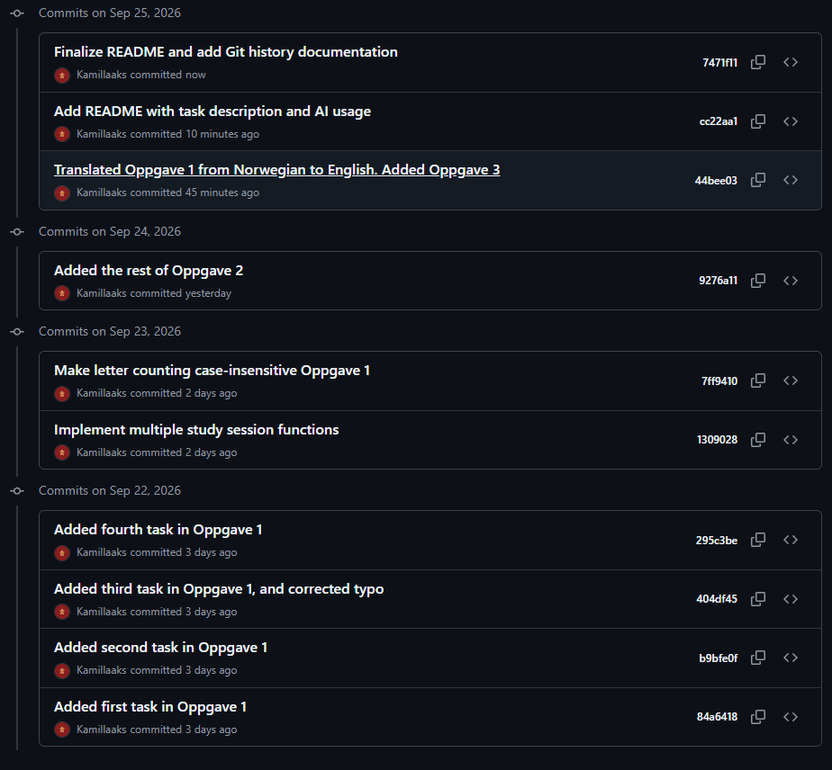

# Arbeidskrav 1 - Python
Navn: Kamilla Selnes

Programmene er skrevet i Python og kan kjøres fra innleveringsmappen.

Eksempel: 
python oppgave-1.py

De øvrige oppgavene kjøres på samme måte ved å endre filnavnet.

## Kjente feil og mangler
Jeg har ikke rukket å fullføre alle oppgavene. Oppgave 3 er delvis påbegynt, men ikke ferdig. Oppgave 4 og 5 er ikke
påbegynt.

Jeg har heller ikke rukket å spille inn videoen som skal følge med innleveringen.

## Oppgave 1
Løsning og fremgangsmåte:
Jeg har delt opp oppgaven i flere funksjoner, og har lagd en meny der brukeren kan velge
hvilken del av programmet som skal kjøres. Jeg valgte å bruke parametere i funksjonene for å få mer trening i dette
siden det er noe jeg tidligere har syns har vært utfordrende og vanskelig å forstå.

Underveis jobbet jeg med å få menyen til å kalle riktig funksjon basert på brukerens valg. Jeg måtte blant annet rette
en feil som oppstod fordi input() returnerer tekst, mens menyvalgene mine ble sammenlignet med heltall.

Bruk av KI i oppgaven:
Jeg valgte å bruke ChatGPT til læringsstøtte for å forstå oppgaveteksten og diskutere funksjoner, parametere og validering
av brukerinput. Jeg brukte det blant annet til å finne relevante kilder og dokumentasjon som jeg kunne lese for å forstå
hvordan jeg skulle løse oppgaven. Jeg brukte også ChatGPT til feilsøking av menyen, der jeg fikk hjelp til å oppdage at 
jeg hadde glemt å konvertere brukerens menyvalg til et heltall med int().

## Oppgave 2
Løsning og fremgangsmåte:
Jeg valgte å bruke en liste med dictionaries for å lagre studieøktene. Hver dictionary representerer en studieøkt, og de 
inneholder tema, varighet i minutter og status.

Jeg valgte denne løsningen fordi hver studieøkt har flere opplysninger som hører sammen. Ved å bruke dictionaries, så
kunne jeg gi opplysningene tydelige nøkler, som topic, duration_minutes og status, i stedet for å være avhengig av 
plasseringen deres i en liste.

Siden alt var samlet i en liste, kunne jeg enkelt legge til nye økter, og gå gjennom dem for å filtrere, søke, sortere 
og beregne samlet studietid. Det gjorde det også mulig å registrere flere økter uten at man måtte opprette egne variabler
for hver av dem.

Bruk av KI i oppgaven:
Jeg valgte å bruke ChatGPT til læringsstøtte og for å finne relevante og gode kilder i denne oppgaven også. Blant annet
brukte jeg den til å diskutere søkefunksjonen, og hvordan man kunne håndtere tilfeller der søket ikke ga noen treff. Jeg 
fikk også forklaringer på any() og str(). Jeg har skrevet og testet koden selv. 

## Oppgave 3
Løsning og fremgangsmåte:
Jeg startet med å dele oppgaven i fire funksjoner, og ga dem hvert sitt ansvarsområde. Den ene skal konvertere dato, en skal beregne sluttidspunkt, en skal beregne antall dager mellom to 
datoer, og den siste skal sortere datoer kronologisk.

Jeg opprettet først funksjonene med midlertidige print()-uttrykk for å få på plass strukturen før jeg skulle begynne å
implementere funksjonaliteten.

Jeg valgte å bruke Pythons datetime-bibliotek, siden det inneholder funksjonalitet for å jobbe med datoer, klokkeslett
og tidsintervaller. Jeg brukte blant annet strptime() for å konvertere tekst til datoer og klokkeslett, og timedelta for
å beregne sluttidspunkt ut fra starttid og varighet.

For å beregne antall dager mellom to datoer brukte jeg differansen mellom datoene og abs() for å sikre at resultatet ble
positivt eller null, uavhengig av hvilken dato brukeren skriver først.

For å sortere datoene har jeg brukt sorted() med key=text_to_date, sånn at datoene sorteres kronologisk i stedet for 
alfabetisk.

Etter at jeg hadde fått beregningsfunksjonene til å funke, laget jeg egne hjelpefunksjoner som håndterer brukerinput, 
validering og utskrift av resultatene. Jeg valgte denne løsningen for å skille beregningslogikken fra brukerinput og utskrift.

Til slutt laget jeg en meny med fem alternativer, sånn at brukeren kan velge hva hen vil gjøre, og avslutte programmet når
hen er ferdig. 

Tester:
| Test | Input | Forventet resultat | Faktisk resultat |
|---|---|---|---|
| 1 | 01.01.2026 | Gyldig dato | Returnerte 2026-01-01 |
| 2 | 31.02.2026 | Ugyldig dato | Viste feilmelding og ba om ny dato |
| 3 | 12:30 og 90 minutter | Sluttid 14:00 | Returnerer 14:00 |
| 4 | 23:30 og 90 minutter | Sluttid 01:00 | Returnerer 01:00 |
| 5 | 12:30 og 0 minutter | Ugyldig varighet | Viser feilmelding og ber om ny varighet |
| 6 | 01.10.2026 og 10.10.2026 | 9 dager | Returnerer 9 dager |
| 7 | To like datoer | 0 dager | Returnerer 0 dager |
| 8 | Flere datoer i tilfeldig rekkefølge | Liste sortert i kronologisk rekkefølge | Listen sorteres kronologisk |
| 9 | Done uten å legge inn datoer | Feilmelding | Brukeren må legge inn minst en dato |

Bruk av KI i oppgaven:
Jeg har brukt ChatGPT som læringsstøtte mens jeg har jobbet med oppgaven. Jeg har fått hjelp til å finne og forstå relevant
dokumentasjon om Pythons standardbibliotek, spesielt datetime, strptime() og timedelta.

Jeg har også brukt ChatGPT til å diskutere hvordan jeg kunne strukturere programmet, sånn at funksjonene som utfører beregningene
tar imot parametere og returnerer resultatene, mens egne hjelpefunksjoner håndterer brukerinput og utskrift.

Jeg fikk også hjelp med å forstå hvordan sorted() kan brukes sammen med key, og tilbakemeldinger på kode jeg hadde skrevet selv,
blant annet rundt validering av brukerinput og plassering av break og continue, når jeg selv hadde "sett meg blind" på koden.

Jeg brukte forklaringene og tilbakemeldingene til å jobbe videre med min egen løsning og testet funksjonaliteten underveis.

Kilder og dokumentasjon:
Jeg brukte den offisielle Python-dokumentasjonen for å lære hvordan man kan jobbe med datoer, klokkeslett og tidsintervaller
ved hjelp av datetime

Tittel: Datetime - Basic date and time types
Kilde: Python Software Foundation
Nettadresse: https://docs.python.org/3/library/datetime.html

## Oppgave 4
Løsning og fremgangsmåte:
Jeg begynte med oppgave 4.1. Jeg brukte csv.DictReader fordi den gjør det lettere å lese CSV-filer siden den automatisk 
kobler sammen radene med kolonnenavnene i filen. Jeg opprettet en tom liste (valid_requests) for å samle henvendelsene som 
oppfylte kravene.

Jeg brukte en for-løkke for å gå gjennom radene og kontrollere at verdiene var gyldige. Om en rad inneholdt ugyldige verdier,
brukte jeg en continue for å hoppe over den og gå videre til neste rad. Jeg brukte også try/except ValueError for å håndtere
feil når ID og minutter skulle konverteres til heltall.

Helt på slutten la jeg til try/except FileNotFoundError for å håndtere tilfeller der CSV-filen ikke finnes. Jeg la også inn en kontroll
som hindrer programmet i å fortsette med analysen om det ikke finnes gyldige henvendelser.

I oppgave 4.2 brukte jeg flere for-løkker for å gå gjennom de gyldige henvendelsene og beregne statistikken. For å telle 
antall henvendelser per kategori brukte jeg en dictionary, der kategorinavnene er nøkler og antall henvendelser er verdier.

Jeg brukte max() sammen med lambda for å finne kategorien med flest henvendelser.

For å sortere de uløste henvendelsene opprettet jeg først en egen liste med henvendelsene som hadde status "no". Så brukte
jeg sorted() med lambda og reverse=True for å sortere dem etter tidsbruk, fra høyest til lavest.

I oppgave 4.3 brukte jeg with open() med "w" for å skrive resultatene fra analysen til en tekstfil. Jeg brukte file.write()
og f-strings til å sette inn verdiene fra variablene jeg lagde i 4.2.

Først skrev jeg ut hele dictionaries og lister direkte, men da ble resultatet vanskelig å lese. Derfor endret jeg på koden 
til å bruke for-løkker, slik at kategoriene og de uløste henvendelsene ble skrevet på hver sin linje.

I oppgave 4.4 fant jeg følgende feil:
- = måtte endres til ==, fordi funksjonen skulle sammenligne verdier og ikke tilordne en ny verdi.
- total = request["minutes"] måtte endres til total += request["minutes"], sånn at minuttene ble lagt til totalsummen i stedet for
å erstatte den.
- return total_minutes måtte endres til return total, fordi det var total som ble brukt til å beregne summen inne i funksjonen.
- Funksjonskallet manglet et argument. Jeg la derfor inn valid_requests da jeg kalte funksjonen.
- Jeg kontrollerte også at innrykkene lå på riktig nivå.

Bruk av KI i oppgaven:
Jeg har brukt ChatGPT som hjelpemiddel under arbeidet med oppgave 4, hovedsakelig for å forstå hvordan ulike deler av Python
funker, diskutere fremgangsmåter og få hjelp til feilsøking.

Jeg har skrevet og testet koden selv, men har fått forklaringer og tilbakemeldinger som har påvirket enkelte deler av løsningen.

4.1 
Jeg brukte ChatGPT til å diskutere validering av data og håndtering av feil. Dette hjalp meg med å forstå hvordan jeg kunne kontrollere
verdiene i CSV-filen og håndtere ugyldige rader.

4.2
Jeg brukte ChatGPT til å forstå og diskutere enkelte metoder for å behandle og sortere data, blant annet bruk av sorted()
og lambda.

4.3
Jeg brukte ChatGPT til å diskutere hvordan jeg kunne gjøre rapporten mer lesbar ved å skrive ut elementene fra dictionaries
og lister på separate linjer.

4.4
Jeg rettet koden selv, men fikk et par hint fra ChatGPT om hvor jeg burde se etter feil. 

## Git-historikk
Jeg har brukt Git under arbeidet med oppgavene.
Commit-historikken er tilgjengelig på Github:

[Se Git-historikken]https://github.com/Kamillaaks/ga-emne1-arbeidskrav1/commits/master/
